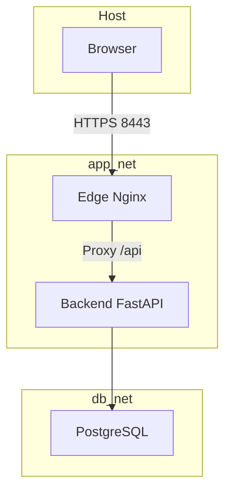

# CriptoMed
> Proyecto de Ética y Seguridad de los Datos – DS3031

Plataforma web que permite a clínicas pequeñas y consultorios independientes centralizar los historiales médicos de sus pacientes de forma segura, con acceso controlado por roles, datos encriptados en reposo y tránsito, y trazabilidad completa de cada acceso o modificación.

**Despliegue:** Docker Compose local con PostgreSQL, FastAPI, React y Nginx con TLS 1.3.

---

## Cómo ejecutar el proyecto

**Requisitos:** Docker y Docker Compose.
1. Generar .env: `python3 scripts/generate_secrets.py --generate-env`
2. Generar certificados: `./scripts/gen_cert.sh`
3. Levantar: `./scripts/dev.sh up`
4. Sembrar datos: `./scripts/dev.sh seed`
5. Abrir: https://localhost:8443 (aceptar certificado autofirmado o importar `certs/cert.pem` como confiable)
6. Usuarios demo: admin@criptomed.local (DEMO_PASSWORD_ADMIN), doctor1@criptomed.local (DEMO_PASSWORD_DOCTOR), admin1@criptomed.local (DEMO_PASSWORD_ADMINISTRATIVO), auditor1@criptomed.local (DEMO_PASSWORD_AUDITOR), paciente1@criptomed.local (DEMO_PASSWORD_PACIENTE). Contraseña para todos: admin123.

**Para reiniciar desde cero:** `./scripts/dev.sh reset`

---

## Arquitectura Docker



**Servicios Docker:**
- **db**: PostgreSQL 16 Alpine - Base de datos con healthcheck
- **backend**: FastAPI con Python 3.12.7 - API REST con healthcheck, usuario no root, filesystem de solo lectura
- **edge**: Nginx 1.27 Alpine - Terminación TLS 1.3, frontend React compilado, proxy a backend
- **init**: Servicio de inicialización (seed) - Crea tablas y carga datos demo

**Redes:**
- `app_net`: Frontend y backend (no internal para exponer puerto 8443 al host)
- `db_net`: Base de datos (internal, solo accesible desde backend)

**Puertos:**
- Solo edge publica puerto `8443:8443` al host
- Puertos 5432 (Postgres) y 8000 (backend) son internos, no expuestos

---

## Modelo de datos

**`usuarios`**
|| Campo | Tipo | Notas |
|---|---|---|
| id | UUID / PK | |
| nombre | string | |
| email | string, único | |
| password_hash | string | bcrypt |
| rol | enum | `admin`, `doctor`, `administrativo`, `auditor`, `paciente` |
| activo | boolean | para revocación de accesos |
| creado_en | timestamp | |

**`pacientes`**
|| Campo | Tipo | Notas |
|---|---|---|
| id | UUID / PK | |
| nombre | string (cifrado AES-256) | |
| apellido | string (cifrado AES-256) | |
| fecha_nacimiento | date | |
| dni | string, único | |
| doctor_id | UUID, FK → usuarios | |
| usuario_id | UUID, FK → usuarios | |
| diagnostico | string (cifrado AES-256) | |
| medicacion | string (cifrado AES-256) | |
| resultado_test | string (cifrado AES-256) | |

**`diagnosticos_cie10`**
|| Campo | Tipo |
|---|---|
| codigo | string / PK |
| descripcion | string |

**`audit_logs`** *(inmutable, solo-lectura salvo el sistema)*
|| Campo | Tipo | Notas |
|---|---|---|
| id | UUID / PK | |
| usuario_id | UUID, FK → usuarios | |
| accion | enum | `login`, `lectura`, `edicion`, `borrado`, `transferencia` |
| recurso | string | ej. `paciente:UUID` |
| timestamp | datetime | |
| ip_origen | string | |
| detalle | string | detalle adicional |

---

## Roles y permisos

|| Rol | Login | Ver pacientes | Ver diagnóstico | Editar pacientes | Gestionar usuarios | Ver audit logs |
|---|---|---|---|---|---|---|
| **Administrador** | ✅ | ✅ | ✅ | ✅ | ✅ | ✅ |
| **Doctor** | ✅ | ✅ (asignados) | ✅ (asignados) | ✅ (asignados) | ❌ | ❌ |
| **Administrativo** | ✅ | ✅ (datos básicos) | ❌ | ✅ (admisión/facturación) | ❌ | ❌ |
| **Auditor** | ✅ | ❌ | ❌ | ❌ | ❌ | ✅ (solo lectura) |
| **Paciente** | ✅ | ✅ (propio) | ✅ (propio) | ❌ | ❌ | ❌ |

---

## Seguridad

|| Medida | Implementación |
|---|---|
| Encriptación en reposo | AES-256 (Fernet) sobre campos sensibles (diagnóstico, medicación, resultado_test) |
| Encriptación en tránsito | HTTPS con TLS 1.3, certificado autofirmado (OpenSSL) |
| Hashing de contraseñas | bcrypt |
| Autenticación | JWT con expiración |
| Autorización | RBAC (5 roles), principio de mínimo privilegio |
| Auditoría | Logs inmutables de login/lectura/edición/borrado/transferencia |
| Usuario no root | Contenedores backend e init corren como UID 10001 |
| Capabilities mínimas | `cap_drop: ALL` + `cap_add` de solo las necesarias |
| No secretos en imágenes | Variables de entorno vía docker-compose.yml, no COPY de .env |
| Healthchecks | pg_isready (db), /health endpoint (backend) |
| Límites de recursos | mem_limit y pids_limit configurados |

Para más detalles de hardening, ver `docs/HARDENING_DOCKER.md`.

---

## Endpoints principales

|| Método | Ruta | Rol requerido | Descripción |
|---|---|---|---|
| POST | `/api/auth/login` | público | Login, retorna JWT |
| GET | `/api/pacientes` | doctor, admin, administrativo | Lista pacientes (campos según rol) |
| GET | `/api/pacientes/{id}` | doctor (asignado), admin | Detalle completo |
| POST | `/api/pacientes` | admin, administrativo | Crear paciente |
| PUT | `/api/pacientes/{id}` | doctor (asignado), admin | Editar historial |
| DELETE | `/api/pacientes/{id}` | admin | Borrado |
| GET | `/api/usuarios` | admin | Gestión de usuarios |
| POST | `/api/usuarios` | admin | Crear usuario |
| PATCH | `/api/usuarios/{id}/revocar` | admin | Revocar acceso |
| GET | `/api/audit-logs` | auditor, admin | Consultar logs (solo lectura) |
| GET | `/api/pacientes/me` | paciente | Ver propio historial |
| GET | `/api/pacientes/doctores` | paciente, admin | Lista doctores disponibles |
| PATCH | `/api/pacientes/{id}/transferir-doctor` | paciente (propio), admin | Transferir paciente a otro doctor |

---

## Documentación

- `docs/DOCKER.md` - Documentación de Docker (diagramas, puertos, volúmenes, debugging)
- `docs/HARDENING_DOCKER.md` - Resumen de hardening Docker con tabla de controles
- `docs/FINAL_REPORT.md` - Informe final completo (cumplimiento normativo, matriz de riesgos, lecciones aprendidas)
- `docs/EXPOSITION_GUIDE.md` - Guía de exposición para demostración

---

## Stack técnico

|| Capa | Tecnología |
|---|---|
| Backend | Python 3.12.7 + FastAPI |
| Base de datos | PostgreSQL 16 Alpine |
| ORM | SQLAlchemy |
| Auth | JWT (`python-jose`) + `bcrypt` |
| Encriptación | `cryptography` (Fernet / AES-256) |
| Frontend | React + Vite |
| Edge | Nginx 1.27 Alpine |
| Orquestación | Docker Compose |
| Control de versiones | Git / GitHub |

---

## Scripts de operación

- `./scripts/dev.sh up` - Genera certificados si faltan, valida .env, build y levanta servicios
- `./scripts/dev.sh seed` - Ejecuta el perfil seed (carga datos demo)
- `./scripts/dev.sh down` - Detiene servicios
- `./scripts/dev.sh reset` - down -v + up + seed
- `./scripts/dev.sh logs` - Muestra logs de servicios
- `./scripts/dev.sh ps` - Muestra estado de servicios
- `./scripts/dev.sh test` - Ejecuta pytest en backend
- `./scripts/dev.sh shell-db` - Abre psql en contenedor db
- `./scripts/verificar_despliegue.sh` - Verifica 8 puntos críticos del despliegue

---

## Estructura del repositorio

```
cripto-med/
├── backend/
│   ├── app/
│   │   ├── main.py
│   │   ├── models.py
│   │   ├── schemas.py
│   │   ├── auth.py
│   │   ├── rbac.py
│   │   ├── crypto.py
│   │   ├── audit.py
│   │   └── routers/
│   ├── scripts/
│   │   ├── setup_db_docker.py
│   │   └── seed_db.py
│   ├── requirements.txt
│   └── .dockerignore
├── frontend/
│   ├── src/
│   ├── package.json
│   └── vite.config.js
├── docker/
│   ├── backend/Dockerfile
│   ├── edge/Dockerfile
│   ├── edge/nginx.conf
│   └── db/init/
│       ├── 01-roles.sql
│       ├── 02-create-tables.sql
│       └──  03-seed.sql
├── scripts/
│   ├── dev.sh
│   ├── dev.ps1
│   ├── gen_cert.sh
│   ├── generate_secrets.py
│   └── verificar_despliegue.sh
├── docs/
│   ├── DOCKER.md
│   ├── HARDENING_DOCKER.md
│   ├── FINAL_REPORT.md
│   └── EXPOSITION_GUIDE.md
├── certs/
│   ├── cert.pem
│   └── key.pem
├── docker-compose.yml
├── .env.example
├── .dockerignore
└── README.md
```

---

## Cumplimiento normativo

- **Ley N° 29733** – Ley de Protección de Datos Personales del Perú (aplicación directa: datos de salud = datos sensibles)
