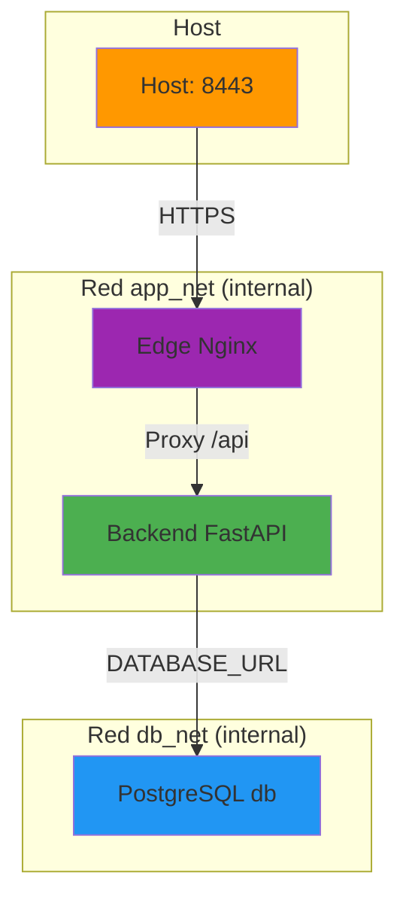

# Docker - CriptoMed

Este documento describe cómo desplegar y gestionar CriptoMed con Docker Compose.

## Arquitectura

El sistema consta de tres servicios principales:

- **db**: PostgreSQL 16 con datos persistentes
- **backend**: FastAPI con el código de la aplicación
- **edge**: Nginx que sirve el frontend React y proxea /api al backend

Solo el edge publica puertos al host (`8443:8443`). Ni db ni backend son accesibles desde fuera de la red Docker.

### Diagrama de servicios y redes



### Tabla de puertos

| Servicio | Puerto interno | Puerto publicado | ¿Publicado al host? | Propósito |
|----------|----------------|------------------|---------------------|-----------|
| edge     | 8443           | 8443             | Sí                  | HTTPS (frontend + /api) |
| edge     | 8080           | -                | No                  | HTTP interno (redirección a HTTPS) |
| backend  | 8000           | -                | No                  | FastAPI (solo accesible desde edge) |
| db       | 5432           | -                | No                  | PostgreSQL (solo accesible desde backend) |

### Volúmenes

| Volumen | Montaje en contenedor | Contenido | Persistencia |
|---------|----------------------|-----------|-------------|
| pgdata  | /var/lib/postgresql/data | Datos de PostgreSQL | Sí (volumen Docker) |
| ./certs | /etc/nginx/certs (edge) | Certificados SSL (cert.pem, key.pem) | No (directorio local, ignorado por git) |
| ./backend/app | /app (backend) | Código de aplicación (desarrollo) | No (directorio local) |

### Qué está dentro/fuera de las imágenes

| Contenedor | Dentro de la imagen | Fuera de la imagen (montado) |
|------------|-------------------|----------------------------|
| db         | PostgreSQL 16, scripts de init | pgdata (volumen), init scripts (bind) |
| backend    | Python 3.12, dependencias pip, código de app | Código de app (bind, desarrollo), certs (no montado) |
| edge       | Nginx, frontend compilado | Certificados SSL (bind, ro) |

## Roles de base de datos

El sistema usa dos roles de PostgreSQL:

- **POSTGRES_USER (criptomed)**: Rol dueño con privilegios para crear tablas y otorgar permisos. Usado solo por `setup_db_docker.py`.
- **APP_DB_USER (app_user)**: Rol de aplicación con privilegios mínimos. Usado por el backend en ejecución.

Permisos de APP_DB_USER:
- Tablas de negocio (usuarios, pacientes, diagnosticos_cie10): SELECT, INSERT, UPDATE, DELETE
- audit_logs: SELECT, INSERT (no UPDATE ni DELETE para evitar modificación de logs de auditoría)

## Inicialización desde cero

Para iniciar el sistema completamente desde cero (borrando todos los datos):

```bash
# 1. Detener contenedores y borrar volúmenes
docker compose down -v

# 2. Generar secretos (si aún no tienes .env)
python3 scripts/generate_secrets.py --generate-env

# 3. Generar certificados SSL autofirmados
./scripts/gen_cert.sh

# 4. Iniciar servicios de base de datos y backend
docker compose up -d db backend

# 5. Esperar a que db esté healthy
docker compose ps

# 6. Ejecutar script de inicialización (crea tablas y otorga permisos)
docker compose --profile seed up init

# 7. Iniciar edge (Nginx + frontend)
docker compose up -d edge
```

O todo en un solo comando:

```bash
docker compose down -v && \
python3 scripts/generate_secrets.py --generate-env && \
./scripts/gen_cert.sh && \
docker compose up -d db backend && \
docker compose --profile seed up init && \
docker compose up -d edge
```

## Inicio normal

Si el sistema ya está inicializado (volumen pgdata existe):

```bash
# 1. Iniciar todos los servicios
docker compose up -d

# 2. Verificar estado
docker compose ps

# 3. Ver logs
docker compose logs -f
```

## Verificar el sistema

```bash
# Verificar que el edge esté sirviendo HTTPS
curl -k https://localhost:8443/health

# Verificar que el backend esté respondiendo
curl -k https://localhost:8443/api/health

# Verificar logs del backend
docker compose logs backend
```

## Scripts de inicialización

### docker/db/init/01-roles.sh

Script que se ejecuta automáticamente cuando se crea el volumen pgdata por primera vez. Crea el rol de aplicación APP_DB_USER con privilegios mínimos.

### backend/scripts/setup_db_docker.py

Script que crea las tablas de la base de datos usando OWNER_DATABASE_URL (rol dueño) y otorga permisos a APP_DB_USER. Debe ejecutarse después de que db esté healthy.

### backend/scripts/seed_db.py

Script que carga datos de ejemplo (usuarios demo, pacientes, diagnósticos CIE-10). Es idempotente: si ya hay datos, los omite. Lee contraseñas de DEMO_PASSWORD_* del .env.

## Re-sedar datos

Para recargar los datos de ejemplo sin borrar la base de datos:

```bash
docker compose --profile seed up init
```

## Solución de problemas

### Cómo depurar

**Verificar healthchecks:**
```bash
# Verificar estado de health de todos los servicios
docker compose ps

# Verificar health específico de db
docker compose exec db pg_isready -U criptomed

# Verificar health específico de backend
curl -k https://localhost:8443/api/health
```

**Ver logs:**
```bash
# Logs de todos los servicios (follow)
docker compose logs -f

# Logs de un servicio específico
docker compose logs backend
docker compose logs edge
docker compose logs db

# Logs de los últimos 100 líneas
docker compose logs --tail=100 backend
```

**Entrar a un contenedor:**
```bash
# Entrar al backend
docker compose exec backend bash

# Entrar a db
docker compose exec db bash

# Entrar a edge
docker compose exec edge sh
```

**Verificar redes:**
```bash
# Listar redes
docker network ls

# Verificar contenedores en una red
docker network inspect cripto-med_app_net
docker network inspect cripto-med_db_net
```

### El edge no puede conectar al backend

Verifica que el backend esté healthy:
```bash
docker compose ps backend
```

Verifica logs del backend:
```bash
docker compose logs backend
```

### Error de permisos en la base de datos

Si APP_DB_USER no tiene permisos, reejecuta setup_db_docker.py:
```bash
docker compose --profile seed up init
```

### Certificados SSL expirados

Regenera los certificados:
```bash
./scripts/gen_cert.sh
docker compose restart edge
```

### El contenedor init no termina

El contenedor init está diseñado para terminar después de ejecutar los scripts. Si no termina, verifica:
- Que db esté healthy
- Que OWNER_DATABASE_URL esté definido en .env
- Logs del contenedor init:
  ```bash
  docker compose logs init
  ```

## Seguridad

- Los certificados SSL están en `certs/` (ignorado por git)
- Las contraseñas están en `.env` (ignorado por git)
- Solo el edge publica puertos al host
- Las redes `app_net` y `db_net` son internas (no accesibles desde el host)
- Los contenedores corren con capacidades mínimas y `no-new-privileges:true`
- El backend no tiene acceso a la red db_net (solo backend tiene acceso a ambas redes)
