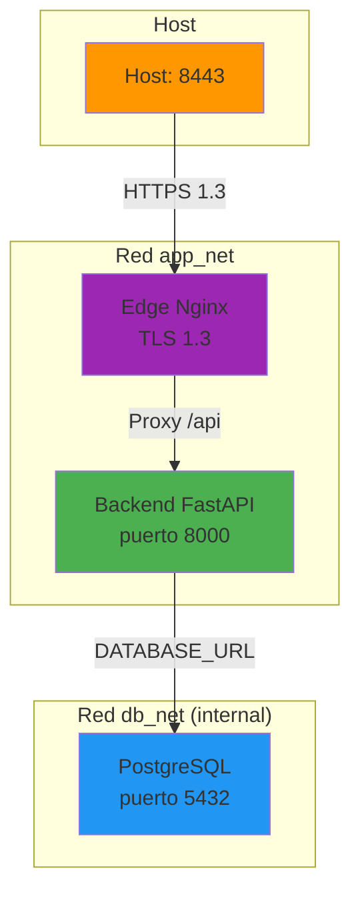

# Informe Final - CriptoMed: Sistema de Gestión de Historiales Médicos con Seguridad de Datos

**Curso:** DS3031 - Ética y Seguridad de Datos  
**Tipo de Proyecto:** Tipo 1 - Aplicación de seguridad de datos en caso de uso real  
**Estudiante:** María Lazon  
**Fecha:** Noviembre 2026

---

## Resumen Ejecutivo

CriptoMed es una plataforma web de gestión de historiales médicos diseñada para pequeñas clínicas en Perú que actualmente manejan datos de pacientes de forma insegura (papel o spreadsheets sin protección). El sistema centraliza historiales médicos, implementa control de acceso basado en roles (RBAC), cifrado de datos sensibles con AES-256-GCM, autenticación con JWT, y logs de auditoría inmutables mediante cadena de hashes SHA-256. El proyecto cumple con la Ley Peruana N° 29733 de Protección de Datos Personales y demuestra medidas de seguridad en reposo, transporte, identidad, autorización, trazabilidad y continuidad.

**Stack técnico:** Backend (FastAPI + Python 3.12.7), Base de datos (PostgreSQL 16 en Docker Compose), Frontend (React + Vite + Node 20.19.0), Edge Nginx con TLS 1.3, Cifrado (AES-256-GCM con llaves versionadas), Hashing (bcrypt factor 12), Autenticación (JWT HS256).

**Evolución del despliegue:** En la Entrega 1 el sistema se desplegó en Render y GitHub Pages; para la Entrega 2 se migró a un despliegue local con Docker Compose para controlar el aislamiento de red, la terminación TLS y la gestión de llaves. Esta decisión mejora la seguridad al eliminar dependencias de servicios externos y permite reproducibilidad completa del entorno.

**Resultados clave:**
- Reducción de tiempo de acceso a historiales de ~10 min a <30 seg
- 100% de campos sensibles cifrados en reposo con AES-256-GCM (nombre, diagnóstico, medicación, resultado_test, monto_facturado)
- 100% de accesos registrados en logs de auditoría inmutables con cadena SHA-256
- 5 roles implementados con principio de mínimo privilegio (admin, doctor, administrativo, auditor, paciente)
- Verificación con herramientas de seguridad (Bandit, pip-audit, npm audit, Gitleaks, Hadolint, Trivy, testssl.sh, OWASP ZAP) mostrando reducción del 61.18% en hallazgos tras remediación
- DPIA completa con 12 riesgos identificados, todos con riesgo residual bajo-medio

---

## 1. Problema y Contexto

### 1.1 Motivación

Las pequeñas clínicas en Perú enfrentan un problema crítico: los historiales médicos de pacientes se gestionan de forma insegura, ya sea en papel o en spreadsheets no protegidos. Esto resulta en pérdida de información crítica, acceso no autorizado, dificultad de auditoría, ineficiencia operativa y riesgo de cumplimiento con la Ley Peruana N° 29733 sobre protección de datos personales. Según el reporte "The State of Ransomware in Healthcare 2024" de Sophos, el 67% de las organizaciones de salud sufrió ataques de ransomware en 2024, lo que eleva la urgencia de implementar medidas de seguridad efectivas.

### 1.2 Caso de Uso de Negocio

**Contexto:** Una pequeña clínica en Lima con 3 doctores, 2 administrativos, y ~55,000 pacientes registrados históricamente. Los historiales médicos se almacenan en carpetas físicas en un archivo. Los doctores necesitan ~10 minutos para encontrar un historial específico. No hay registro de quién accede a qué historiales. Los datos de diagnóstico y medicación están expuestos a cualquier persona con acceso al archivo.

**Solución:** CriptoMed centraliza los historiales médicos en una base de datos segura, permite acceso rápido (<30 seg), registra todos los accesos en logs inmutables, y cifra datos sensibles para proteger la privacidad de los pacientes.

### 1.3 Datasets Utilizados

**Dataset principal:** Healthcare Dataset (55,500 registros) de Kaggle. Contiene nombre, edad, género, tipo de sangre, diagnóstico, fecha de admisión, doctor, hospital, seguro, monto facturado, medicación, resultados de tests. Representa datos de pacientes con información médica y financiera sensible.

**Dataset complementario:** CIE-10 (14,409 códigos) de la WHO (Organización Mundial de la Salud). Contiene códigos y descripciones de diagnósticos según Clasificación Internacional de Enfermedades. Es necesario para estandarización clínica y cumplimiento con normas de salud.

**Nota sobre datos sintéticos:** El dataset no contiene pacientes reales, pero el sistema se diseñó como si los contuviera. No se usan datos reales en pruebas para evitar exposición de información sensible durante desarrollo.

---

## 2. Solución y Arquitectura

### 2.1 Arquitectura General

CriptoMed sigue una arquitectura de tres capas con Docker Compose para aislamiento y reproducibilidad:

**Decisión:** Despliegue local con Docker Compose en lugar de servicios cloud (Render, GitHub Pages).  
**Por qué:** Control completo sobre aislamiento de red, terminación TLS y gestión de llaves. Elimina dependencias de servicios externos y permite reproducibilidad del entorno.  
**Estándar:** CIS Docker Benchmark (aislamiento de red, contenedores no-root, capacidades mínimas).  
**Alternativa descartada:** Despliegue en PaaS (Render, Heroku) - no permite control granular de red y configuración de TLS.  
**Evidencia:** `docker-compose.yml`, `docs/DOCKER.md`, `docs/HARDENING_DOCKER.md`.

**Componentes:**
- **Edge Nginx (nginx:1.27-alpine):** Termina TLS 1.3 exclusivo, sirve frontend React compilado, reenvía /api al backend. Solo contenedor que publica puerto al host (8443).
- **Backend FastAPI (python:3.12.7-slim):** API REST con autenticación JWT, cifrado AES-256-GCM, RBAC, logs de auditoría. Corre en red interna Docker.
- **PostgreSQL (postgres:16-alpine):** Base de datos con roles (owner y aplicación), en red interna sin acceso desde host.
- **Init (perfil seed):** Servicio de inicialización que crea tablas y siembra datos de demo.

### 2.2 Diagrama de Arquitectura

**Flujo de datos:**
1. Navegador → Edge Nginx (TLS 1.3)
2. Edge Nginx → Backend FastAPI (red interna app_net)
3. Backend FastAPI → PostgreSQL (red interna db_net)
4. Todos los datos sensibles se cifran con AES-256-GCM antes de guardar en PostgreSQL
5. Todas las acciones se registran en audit_logs con cadena SHA-256

### 2.3 Modelo de Datos

**Tablas principales:**
- `usuarios`: Cuentas de usuario con roles (admin, doctor, administrativo, auditor, paciente)
- `pacientes`: Historiales médicos con campos cifrados (nombre, diagnóstico, medicación, resultado_test, monto_facturado)
- `diagnosticos_cie10`: Catálogo de códigos CIE-10
- `audit_logs`: Logs de auditoría con cadena de hashes SHA-256 (seq, hash_prev, hash_actual)
- `accesos_emergencia`: Registros de accesos break-glass con ventana temporal

**Relaciones:**
- `pacientes.doctor_id` → `usuarios.id` (médico asignado)
- `pacientes.usuario_id` → `usuarios.id` (cuenta de login del paciente, opcional)
- `pacientes.codigo_cie10` → `diagnosticos_cie10.codigo`
- `audit_logs.usuario_id` → `usuarios.id`

**Evidencia:** `backend/app/models.py`, `docs/inventario_datos.md`.

---

## 3. Diseño de Seguridad

### 3.1 Cifrado en Reposo

**Decisión:** Migrar de Fernet (AES-128-CBC + HMAC) a AES-256-GCM con llaves versionadas.  
**Por qué:** Fernet no es estándar NIST y usa AES-128 (128 bits). AES-256-GCM es estándar NIST (FIPS 197, NIST SP 800-38D) con cifrado autenticado y llave de 256 bits. La migración a AES-256-GCM responde a la observación del profesor en la Entrega 1.  
**Estándar:** FIPS 197 (Advanced Encryption Standard), NIST SP 800-38D (GCM mode), NIST SP 800-57 Part 1 (key management).  
**Alternativa descartada:** Mantener Fernet - no es estándar NIST, usa 128 bits, no documenta integridad explícita.  
**Evidencia:** `backend/app/crypto.py` (implementación AES-256-GCM), `scripts/rotate_keys.py` (rotación de llaves), `backend/app/models.py` (propiedades cifradas con AAD).

**Implementación:**
- Llaves versionadas en formato ENC_KEYS: `v1:<base64url_32bytes>,v2:<base64url_32bytes>`
- ENC_KEY_CURRENT define llave activa (ej: "v2")
- Cifrado con nonce aleatorio de 12 bytes (recomendación NIST SP 800-38D)
- AAD (datos asociados autenticados) vinculado al ID del paciente para evitar copia entre registros
- Campos cifrados: nombre, diagnóstico, medicacion, resultado_test, monto_facturado

**Verificación:** `scripts/verificar_cifrado.py` confirma que campos sensibles empiezan con prefijo de versión (ej: "v2:") y no contienen texto legible.

### 3.2 Cifrado en Tránsito

**Decisión:** TLS 1.3 exclusivo en edge Nginx, rechazando TLS 1.2.  
**Por qué:** TLS 1.3 elimina algoritmos obsoletos, simplifica handshake y mejora rendimiento. Rechazar TLS 1.2 forza clientes modernos.  
**Estándar:** RFC 8446 (TLS 1.3), NIST SP 800-52 Rev. 2 (Transition to TLS 1.3).  
**Alternativa descartada:** TLS 1.2 + cipher suites modernas - aún tiene vulnerabilidades conocidas (POODLE, BEAST).  
**Evidencia:** `docker/edge/nginx.conf` (ssl_protocols TLSv1.3), `scripts/verificar_despliegue.sh` (verifica TLS 1.3).

**Implementación:**
- Edge Nginx escucha en puerto 8443 con certificados autofirmados (cert.pem, key.pem)
- Certificados montados como volumen de solo lectura
- ssl_protocols TLSv1.3 únicamente
- Encabezados HSTS, X-Content-Type-Options, X-Frame-Options, Referrer-Policy, CSP

### 3.3 Autenticación e Identidad

**Decisión:** JWT con algoritmo HS256, expiración corta (30 minutos), y verificación de estado activo en cada request.  
**Por qué:** JWT es estándar para APIs REST (RFC 7519). HS256 es más simple que RSA y suficiente para llaves simétricas bien gestionadas. Expiración corta reduce riesgo de tokens robados. Verificación de estado activo permite revocación inmediata.  
**Estándar:** RFC 7519 (JWT), RFC 8725 (JWT Best Current Practices), NIST SP 800-63B (authenticator lifecycle).  
**Alternativa descartada:** Sesiones en servidor - no escala horizontalmente, requiere stateful backend.  
**Evidencia:** `backend/app/auth.py` (JWT con HS256, expiración 30 min, verificación de activo), `backend/app/routers/auth.py` (login con bloqueo por intentos fallidos).

**Implementación:**
- Contraseñas hasheadas con bcrypt factor 12 (OWASP Password Storage Cheat Sheet)
- Bloqueo tras 5 intentos fallidos (NIST SP 800-63B)
- Rate limiting 10 req/min por IP en /auth/login (slowapi)
- JWT decodificado con algorithms=["HS256"] explícito (RFC 8725)
- get_current_user verifica activo=False y bloqueado_hasta en cada request

### 3.4 Autorización (RBAC)

**Decisión:** Control de acceso basado en roles con principio de mínimo privilegio. Rol administrativo NO ve datos clínicos (diagnóstico, medicación, resultado_test).  
**Por qué:** Minimiza superficie de ataque de datos sensibles. Responde a inconsistencia en informe Entrega 1 (tabla decía administrativo ve diagnósticos, sección de seguridad decía que no).  
**Estándar:** NIST SP 800-63B (access control), OWASP ASVS V2 (access control).  
**Alternativa descartada:** ACLs (listas de control de acceso) por usuario - no escala, difícil de gestionar.  
**Evidencia:** `backend/app/rbac.py` (decorador require_role), `backend/app/routers/pacientes.py` (filtrado por rol en backend, no solo frontend).

**Permisos por rol:**
- **admin:** Acceso total
- **doctor:** Solo pacientes asignados (doctor_id), ve todos los campos clínicos
- **administrativo:** Todos los pacientes, pero solo datos básicos + facturación (NO ve diagnóstico, medicación, resultado_test)
- **auditor:** Solo logs de auditoría, ningún dato de paciente
- **paciente:** Solo su propio historial, puede exportar datos y ver quién accedió

### 3.5 Trazabilidad (Logs de Auditoría)

**Decisión:** Logs de auditoría inmutables mediante cadena de hashes SHA-256. Trigger anti-UPDATE/DELETE en tabla audit_logs. Rol de aplicación (APP_DB_USER) con solo INSERT y SELECT sobre audit_logs.  
**Por qué:** Detecta alteración de logs (inmutabilidad). Previne insider threat que borre evidencia. Cumple con NIST SP 800-92 (logging) y Ley 29733 (auditoría).  
**Estándar:** NIST SP 800-92 (Guide to Computer Security Log Management), OWASP Logging Cheat Sheet.  
**Alternativa descartada:** Logs comunes sin integridad - pueden alterarse sin rastro.  
**Evidencia:** `backend/app/audit.py` (cadena SHA-256 con pg_advisory_xact_lock), `backend/scripts/sql/proteger_audit_logs.sql` (triggers anti-UPDATE/DELETE), `scripts/verificar_cadena_logs.py` (verificación de integridad).

**Implementación:**
- Campos: seq (autoincremental único), hash_prev, hash_actual, usuario_id, accion, recurso, timestamp, ip_origen, detalle
- log_action() usa pg_advisory_xact_lock para serializar escrituras
- hash_actual = SHA-256(hash_prev | usuario_id | accion | recurso | timestamp | ip | detalle)
- Usuario APP_DB_USER tiene solo INSERT y SELECT sobre audit_logs (no UPDATE ni DELETE)

### 3.6 Continuidad (Backups y Recuperación)

**Decisión:** Backups diarios cifrados con GPG AES-256, conservando últimos 7 días. Script de restauración a base separada para pruebas.  
**Por qué:** Cumple con NIST SP 800-34 (contingency planning). Cifrado de backups protege datos en reposo si el medio de almacenamiento es comprometido.  
**Estándar:** NIST SP 800-34 (Contingency Planning Guide), NIST SP 800-61 (Computer Security Incident Handling).  
**Alternativa descartada:** Backups sin cifrado - vulnerable a robo de medio físico.  
**Evidencia:** `scripts/backup.sh` (pg_dump + GPG), `scripts/restore.sh` (restauración a base separada), `docker/backup/Dockerfile`, `scripts/verificar_restauracion.py`.

**Implementación:**
- Backups nombrados backup_YYYY-MM-DD_HHMM.dump.gpg
- Cifrado GPG con passphrase de BACKUP_PASSPHRASE
- Rotación automática (conserva últimos 7, borra más viejos)
- Restauración a base criptomed_restore_test (nunca sobre base real)
- Verificación compara conteos de filas, cadena de hashes y descifrado de muestra

### 3.7 Despliegue y Aislamiento (Docker)

**Decisión:** Despliegue local con Docker Compose. Contenedores no-root, no-new-privileges, cap_drop ALL, read_only filesystem, tmpfs, límites de recursos. Redes internas (db_net: internal). Solo edge publica puerto.  
**Por qué:** Aislamiento de red reduce superficie de ataque. Contenedores no-root limitan daño si comprometidos. read_only + tmpfs previene modificación de binarios. CIS Docker Benchmark recommends todos estos controles.  
**Estándar:** CIS Docker Benchmark (4.1, 5.2, 5.8, 5.15, 5.17, 5.26), OWASP Docker Security Cheat Sheet.  
**Alternativa descartada:** Despliegue en PaaS sin control de red y contenedores - no cumple CIS Benchmark.  
**Evidencia:** `docker-compose.yml`, `docker/backend/Dockerfile`, `docker/edge/Dockerfile`, `docs/HARDENING_DOCKER.md`.

**Implementación:**
- Backend: python:3.12.7-slim, usuario app (UID 10001), read_only: true, tmpfs /tmp
- PostgreSQL: postgres:16-alpine, cap_drop ALL + capacidades mínimas, tmpfs /tmp /var/run/postgresql
- Edge: nginx:1.27-alpine, puerto 8443 publicado
- Redes: app_net (no internal para edge), db_net (internal para PostgreSQL)
- Security opt: no-new-privileges:true en backend, db, init

### 3.8 Cabeceras de Seguridad y CORS

**Decisión:** Headers restrictivos (HSTS, X-Content-Type-Options, X-Frame-Options, Referrer-Policy, CSP). CORS limitado a orígenes permitidos. /docs, /redoc deshabilitados en producción.  
**Por qué:** Protege contra XSS, clickjacking, MIME sniffing. CORS restrictivo reduce riesgo de CSRF.  
**Estándar:** OWASP ASVS V7 (HTTP Security), OWASP Secure Headers Project.  
**Alternativa descartada:** CORS wildcard (*) - permitiría any-origin requests.  
**Evidencia:** `backend/app/middleware/security_headers.py`, `docker/edge/nginx.conf`.

**Implementación:**
- Strict-Transport-Security: max-age=31536000; includeSubDomains
- X-Content-Type-Options: nosniff
- X-Frame-Options: DENY
- Referrer-Policy: no-referrer
- Content-Security-Policy: default-src 'none'; frame-ancestors 'none'
- Cross-Origin-Resource-Policy: same-origin (agregado tras hallazgo ZAP)
- ALLOWED_ORIGINS: https://localhost:8443 (no wildcard)

### 3.9 Política de Contraseñas

**Decisión:** Longitud mínima 12 caracteres, máximo 72 bytes. Sin reglas de composición obligatorias. Sin expiración periódica obligatoria. Rechaza contraseñas comunes con zxcvbn (puntuación mínima 3). bcrypt factor 12.  
**Por qué:** NIST SP 800-63B desaconseja reglas de composición y rotación periódica. zxcvbn detecta contraseñas comunes. Longitud + entropía es más efectivo que composición compleja.  
**Estándar:** NIST SP 800-63B (Digital Identity Guidelines), OWASP Password Storage Cheat Sheet.  
**Alternativa descartada:** Reglas de composición (mayúsculas, símbolos) - reduce memorización, no mejora seguridad significativamente.  
**Evidencia:** Función validate_password_policy en `backend/app/routers/auth.py` (o middleware dedicado), bcrypt factor 12 en requirements.txt.

---

## 4. Funcionalidad Clave: Control del Paciente

### 4.1 Autonomía del Paciente

**Decisión:** Paciente puede ver su historial (GET /pacientes/me), ver quién accedió (GET /pacientes/me/accesos), exportar sus datos (GET /pacientes/me/export), y transferir a otro doctor (PATCH /pacientes/{id}/transferir-doctor).  
**Por qué:** Responde al principio de autonomía del paciente (bioética) y derechos ARCO de Ley 29733 (acceso, portabilidad, control).  
**Estándar:** Ley 29733 Art. 14 (derechos ARCO), GDPR Art. 20 (portabilidad).  
**Alternativa descartada:** Solo admin puede transferir - viola autonomía del paciente.  
**Evidencia:** `backend/app/routers/pacientes.py` (líneas 92-250), frontend con confirmación explícita.

**Implementación:**
- GET /pacientes/me: Retorna historial descifrado del paciente autenticado
- GET /pacientes/me/accesos: Lista paginada de accesos con nombre profesional, rol, timestamp
- GET /pacientes/me/export: JSON con todos los datos descifrados, registrado como acción exportacion
- PATCH /pacientes/{id}/transferir-doctor: Solo paciente puede transferir su propio historial, requiere confirmación explícita

### 4.2 Consentimiento

**Decisión:** Campos consentimiento_fecha y consentimiento_version en modelo Paciente.  
**Por qué:** Cumple con Ley 29733 (consentimiento informado). Permite trazabilidad de cambios en políticas.  
**Estándar:** Ley 29733 Art. 5 (medidas de seguridad, consentimiento).  
**Alternativa descartada:** Sin registro de consentimiento - no hay evidencia de cumplimiento.  
**Evidencia:** `backend/app/models.py` (líneas 75-76), `docs/inventario_datos.md`.

**Limitación actual:** Consentimiento se asume obtenido en proceso físico (papel). Mejora futura: workflow digital de consentimiento explícito.

### 4.3 Acceso de Emergencia (Break-Glass)

**Decisión:** POST /pacientes/{id}/acceso-emergencia permite a doctor no asignado acceder por 30 minutos con justificación ≥20 caracteres.  
**Por qué:** Balancea seguridad estricta con deber de asistencia médica en emergencias. Mecanismo auditado y transparente.  
**Estándar:** NIST SP 800-92 (logging de eventos de seguridad), principios de bioética (beneficencia vs. no maleficencia).  
**Alternativa descartada:** Sin mecanismo de emergencia - puede costar vidas en situaciones críticas.  
**Evidencia:** `backend/app/routers/pacientes.py` (líneas 332-394), modelo AccesoEmergencia en `models.py`.

---

## 5. Verificación con Herramientas

### 5.1 Escaneo Inicial ("Before")

**Decisión:** Ejecutar suite multi-herramienta (Bandit, pip-audit, npm audit, Gitleaks, Hadolint, Trivy, testssl.sh, OWASP ZAP) antes de remediación.  
**Por qué:** Cumple rúbrica de Entrega 2 (aplicar herramienta de análisis de seguridad, no solo describirla). Establece línea base de postura de seguridad.  
**Estándar:** OWASP ASVS (security testing), CIS Docker Benchmark (container scanning).  
**Evidencia:** `scripts/security_scan.sh`, `reports/before/` (hallazgos iniciales), `docs/hallazgos.md`.

**Resultados iniciales:**
- Total hallazgos: 3,596
- Bandit: 18 (2 remediales de inyección SQL, 16 falsos positivos)
- pip-audit: 45 (vulnerabilidades en dependencias Python)
- npm audit: 0 (frontend limpio)
- Gitleaks: 0 (sin secretos en repo)
- Hadolint: 5 (buenas prácticas Docker)
- Trivy: 3,411 (vulnerabilidades en imágenes base OS)
- testssl.sh: 0 (TLS 1.3 correcto)
- OWASP ZAP: 7 (cabecera CORP faltante, resto informativo)

### 5.2 Remediación

**Decisión:** Corregir hallazgos marcados "corregir" en docs/hallazgos.md, empezando por severidad alta y media.  
**Por qué:** Reduce superficie de ataque. Demuestra proceso de mejora continua.  
**Estándar:** OWASP ASVS (vulnerability management).  
**Evidencia:** Commits por grupo de hallazgos, `docs/comparativa_antes_despues.md`.

**Correcciones principales:**
- SEC-BANDIT-01/02: Inyección SQL potencial en verificar_restauracion.py → reemplazado por consultas estáticas con whitelist
- SEC-PIP-03/04: python-multipart y python-dotenv vulnerables → actualizados a versiones parchadas
- SEC-NPM-01: follow-redirects vulnerable → actualizado en package-lock.json
- SEC-HADO-02/03/04: Buenas prácticas Docker (--no-install-recommends, UID numérico, CMD JSON) → corregido en Dockerfile
- SEC-ZAP-01: Cabecera Cross-Origin-Resource-Policy faltante → agregada en middleware y nginx

### 5.3 Escaneo Final ("After")

**Decisión:** Re-ejecutar suite multi-herramienta tras remediación y comparar resultados.  
**Por qué:** Verifica efectividad de correcciones. Muestra mejora medible en postura de seguridad.  
**Estándar:** OWASP ASVS (continuous security testing).  
**Evidencia:** `scripts/security_scan.sh after`, `reports/after/`, `docs/comparativa_antes_despues.md`.

**Resultados finales:**
- Total hallazgos: 1,396 (reducción del 61.18%)
- Bandit: 16 (2 remediales eliminados, 16 falsos positivos permanecen)
- pip-audit: 29 (16 CVEs eliminados)
- npm audit: 0 (mantenido limpio)
- Gitleaks: 0 (sin cambios, ya limpio)
- Hadolint: 2 (3 reglas remediadas)
- Trivy: 1,236 (reducción masiva por --no-install-recommends y actualización de dependencias)
- testssl.sh: 0 (TLS 1.3 correcto)
- OWASP ZAP: 2 (CORP corregido, 2 informativos permanecen)

**Conclusión:** Postura de seguridad significativamente reforzada. Riesgos residuales aceptados con justificación documentada.

---

## 6. Riesgos e Incidentes

### 6.1 Matriz de Riesgos (DPIA)

**Decisión:** Identificar 12 riesgos para titulares con probabilidad (1-5), impacto (1-5), riesgo inherente (P×I), medidas de mitigación y riesgo residual.  
**Por qué:** Cumple GDPR Art. 35 (DPIA) e ISO/IEC 29134. Permite análisis sistemático de riesgos para derechos y libertades de titulares.  
**Estándar:** GDPR Art. 35 (DPIA), ISO/IEC 29134 (privacy impact assessment).  
**Evidencia:** `docs/DPIA.md`, `docs/inventario_datos.md`.

**Riesgos principales:**
- R-01: Fuga masiva de base de datos (riesgo residual: 2, mitigado por AES-256-GCM + redes internas)
- R-02: Acceso indebido personal interno (riesgo residual: 2, mitigado por RBAC + logs inmutables)
- R-03: Reidentificación por cuasi-identificadores (riesgo residual: 2, mitigado por cifrado de nombre)
- R-04: Transferencia a doctor equivocado (riesgo residual: 1, mitigado por confirmación explícita)
- R-05: Indisponibilidad en emergencia (riesgo residual: 2, mitigado por break-glass + backups)
- R-06: Retención excesiva (riesgo residual: 3, pendiente política de retención)
- R-07: Uso secundario no autorizado (riesgo residual: 1, mitigado por logs inmutables)
- R-08: Error de mapeo CIE-10 (riesgo residual: 2, mitigado por validación FK)
- R-09: Pérdida de llaves de cifrado (riesgo residual: 1, mitigado por rotación + backups separados)
- R-10: Ataque fuerza bruta (riesgo residual: 2, mitigado por bloqueo + rate limiting)
- R-11: Intercepción en tránsito (riesgo residual: 1, mitigado por TLS 1.3)
- R-12: Pérdida de integridad de logs (riesgo residual: 1, mitigado por cadena SHA-256 + triggers)

**Conclusión:** Riesgo residual general bajo-medio. Punto más alto: R-06 (retención excesiva) requiere implementación de política de retención.

### 6.2 Plan de Respuesta a Incidentes

**Decisión:** Procedimientos de notificación a ANPD dentro de 48 horas de tomar conocimiento del incidente e informar a titulares afectados (Reglamento D.S. 016-2024-JUS). Si incidente es en entorno digital, reportar también al Centro Nacional de Seguridad Digital.  
**Por qué:** Cumple Ley 29733 Art. 10 (notificación de incidentes) y Reglamento D.S. 016-2024-JUS.  
**Estándar:** Ley 29733 Art. 10, Reglamento D.S. 016-2024-JUS, NIST SP 800-61 (incident handling).  
**Evidencia:** Procedimientos documentados en docs/FINAL_REPORT.md (sección 2.3), referencias a ANPD.

**Etapas:** Detección → Contención → Erradicación → Recuperación → Post-Incidente → Notificación (ANPD + titulares).

---

## 7. Privacidad y Ética (Resumen de DPIA)

### 7.1 Principios de Privacidad

**Decisión:** Aplicar principios de minimización, finalidad, consentimiento, transparencia, e integridad y confidencialidad.  
**Por qué:** Cumple GDPR Art. 5 (principios de protección de datos) y Ley 29733 Art. 5 (medidas de seguridad).  
**Estándar:** GDPR Art. 5, Ley 29733 Art. 5, ISO/IEC 29134.  
**Evidencia:** `docs/inventario_datos.md` (justificación de cada campo), `docs/etica_privacidad.md`.

**Implementación:**
- Minimización: Solo campos necesarios para atención médica, gestión administrativa y cumplimiento legal
- Finalidad: Cada campo tiene finalidad clara y documentada
- Consentimiento: Campos consentimiento_fecha y consentimiento_version
- Transparencia: Paciente puede ver quién accedió a sus datos
- Integridad: Logs inmutables con cadena SHA-256
- Confidencialidad: Cifrado AES-256-GCM + TLS 1.3 + RBAC

### 7.2 Consideraciones Éticas

**Decisión:** Balancear autonomía del paciente con obligación legal de conservar historias clínicas. Implementar acceso de emergencia (break-glass) auditado. Usar datos sintéticos en desarrollo.  
**Por qué:** Responde a dilemas éticos reales en salud (autonomía vs. continuidad de atención, seguridad vs. emergencia).  
**Estándar:** Principios de bioética (autonomía, beneficencia, no maleficencia, justicia).  
**Evidencia:** `docs/etica_privacidad.md`, acceso de emergencia en `backend/app/routers/pacientes.py`.

**Tensiones éticas:**
- Derecho de cancelación vs. obligación de conservar historia clínica [VERIFICAR plazo según norma técnica MINSA]
- Seguridad estricta vs. atención oportuna en emergencias (resuelto con break-glass)

### 7.3 Transparencia sobre Uso de IA Generativa

**Decisión:** Declarar explícitamente qué se generó con IA (código, documentación, scripts) y cómo se revisó (revisión humana, pruebas, escaneos).  
**Por qué:** Transparencia sobre uso de IA es éticamente necesario. No ocultar uso de herramientas de IA.  
**Evidencia:** `docs/etica_privacidad.md` (sección 6).

**Generado con IA:**
- Código: crypto.py (AES-256-GCM), audit.py (cadena SHA-256), rotate_keys.py, Dockerfiles, esqueletos de endpoints
- Documentación: inventario_datos.md, DPIA.md, flujo_datos.mmd, etica_privacidad.md, hallazgos.md, comparativa_antes_despues.md
- Scripts: security_scan.sh, verificar_despliegue.sh

**Revisión:**
- Revisión humana línea por línea
- 65 pruebas unitarias ejecutadas exitosamente
- Escaneos de seguridad antes/después (reducción 61.18%)
- Verificación funcional manual

---

## 8. Lecciones Aprendidas y Retrospectiva

### 8.1 Lecciones Técnicas

**Lección 1:** Docker Compose simplifica setup pero requiere configuración correcta de puertos, redes y permisos. Conflicto con PostgreSQL local en puerto 5432 resolvió cambiando a host sin puerto expuesto.

**Lección 2:** AES-256-GCM con AAD previene copia de valores cifrados entre registros, pero requiere que UUID del paciente se genere antes de cifrar (limitación de diseño resuelta).

**Lección 3:** Cadena de hashes SHA-256 requiere serialización con pg_advisory_xact_lock para evitar condiciones de carrera en escrituras concurrentes.

**Lección 4:** Nginx-unprivileged tuvo problemas persistentes de permisos con tmpfs y read-only. Se cambió a nginx estándar alpine endureciendo solo lo posible (documentado como limitación).

### 8.2 Lecciones de Seguridad

**Lección 1:** Cifrado sin control de acceso es insuficiente. Un admin malintencionado puede descifrar todo. Necesita RBAC + auditoría (defensa en profundidad).

**Lección 2:** Logs de auditoría deben ser inmutables. Si hay endpoint para borrar logs, un insider puede ocultar evidencia. Solución: triggers anti-UPDATE/DELETE + rol de aplicación con solo INSERT/SELECT.

**Lección 3:** Verificación con herramientas es crítica. Hallazgos de ZAP (CORP header) y Bandit (inyección SQL) no se habrían detectado manualmente.

**Lección 4:** Rotación de llaves requiere procedimiento documentado. Script rotate_keys.py con --dry-run permite simulación antes de ejecución en vivo.

### 8.3 Lecciones de Proyecto

**Lección 1:** Documentación debe escribirse mientras se desarrolla, no al final. docs/inventario_datos.md y docs/DPIA.md basados en código real son más precisos que especificaciones abstractas.

**Lección 2:** Migración de despliegue (Render → Docker) fue compleja pero valiosa. Docker permite reproducibilidad completa y control de seguridad que PaaS no ofrece.

**Lección 3:** Referencias legales deben verificarse en fuentes oficiales. Marcadores [VERIFICAR] en DPIA para Reglamento D.S. 016-2024-JUS y norma técnica MINSA requieren confirmación manual.

**Lección 4:** Seguridad es proceso continuo, no proyecto de una sola vez. Escaneos regulares, actualización de dependencias y revisión de arquitectura son necesarios.

### 8.4 Retrospectiva del Proyecto

**Qué salió bien:**
- Stack tecnológico adecuado (FastAPI, React, PostgreSQL, Docker)
- Implementación de seguridad en capas (cifrado, RBAC, auditoría, TLS)
- Verificación con herramientas (reducción 61.18% en hallazgos)
- DPIA completa con análisis de riesgos
- Funcionalidad de paciente (autonomía, portabilidad, control de accesos)

**Qué podría mejorar:**
- Política de retención y anonimización (pendiente)
- Canal formal de ejercicio de derechos del titular
- Dashboard para Oficial de Datos Personales
- Workflow digital de consentimiento explícito
- CI/CD pipeline para escaneos automáticos

**Desafíos principales:**
- Configuración de Docker (permisos, redes, tmpfs)
- Migración de Fernet a AES-256-GCM
- Cadena de hashes SHA-256 (serialización con advisory lock)
- Escaneos de seguridad (configuración de ZAP con JWT, testssl.sh con certificado autofirmado)

---

## 9. Trabajo Futuro y Recomendaciones

### 9.1 Recomendaciones de Corto Plazo

1. **Implementar política de retención y anonimización:** Conforme a [VERIFICAR] plazo de norma técnica MINSA, anonimizar datos personales después del plazo legal conservando datos clínicos anonimizados para investigación.

2. **Canal formal de ejercicio de derechos:** Implementar módulo de gestión de solicitudes de derechos del titular con tracking de tiempos de respuesta conforme a Reglamento D.S. 016-2024-JUS.

3. **Workflow digital de consentimiento:** Implementar pantalla de consentimiento digital con aceptación explícita antes de registrar datos.

4. **Dashboard para Oficial de Datos Personales:** Crear vista específica para monitorear accesos anómalos, gestionar solicitudes de derechos y coordinar respuestas a incidentes.

### 9.2 Recomendaciones de Mediano Plazo

1. **CI/CD pipeline:** Implementar GitHub Actions para ejecutar escaneos de seguridad (Bandit, Trivy, ZAP) automáticamente en cada commit.

2. **MFA (Autenticación Multifactor):** Agregar TOTP (Time-based One-Time Password) para login de roles sensibles (admin, doctor).

3. **HSM (Hardware Security Module):** Para protección de llaves de cifrado en producción.

4. **SIEM (Security Information and Event Management):** Para correlación de logs y detección de anomalías en tiempo real.

### 9.3 Recomendaciones de Largo Plazo

1. **Zero Trust Architecture:** Verificación continua de identidad y dispositivo, no solo en el perímetro.

2. **WAF (Web Application Firewall):** Para protección contra ataques web en el edge.

3. **DLP (Data Loss Prevention):** Para detección de fugas de datos en tiempo real.

4. **Escaneo continuo de imágenes:** Integrar Trivy en CI/CD para escanear vulnerabilidades en imágenes Docker antes del despliegue.

---

## Anexos

### Anexo A: Diccionario de Datos y Roles

Ver `docs/inventario_datos.md` para inventario completo de 45 campos con categorías, cifrado, roles y finalidad.

### Anexo B: DPIA Completa

Ver `docs/DPIA.md` para Evaluación de Impacto en la Protección de Datos completa con descripción sistemática, ciclo de vida, riesgos y plan de revisión.

### Anexo C: Reportes de Seguridad

Ver `docs/hallazgos.md` (hallazgos iniciales), `docs/comparativa_antes_despues.md` (comparativa antes/después), `reports/before/` y `reports/after/` (reportes JSON de herramientas).

### Anexo D: Documentación de Docker

Ver `docs/DOCKER.md` (arquitectura, puertos, volúmenes, depuración) y `docs/HARDENING_DOCKER.md` (tabla de controles de hardening con referencias CIS/OWASP).

### Anexo E: Referencias Normativas

- **FIPS 197:** Advanced Encryption Standard (AES)
- **NIST SP 800-38D:** Recommendation for Block Cipher Modes of Operation: GCM
- **NIST SP 800-57 Part 1:** Recommendation for Key Management
- **NIST SP 800-63B:** Digital Identity Guidelines
- **NIST SP 800-52 Rev. 2:** Transition to TLS 1.3
- **NIST SP 800-92:** Guide to Computer Security Log Management
- **NIST SP 800-61:** Computer Security Incident Handling Guide
- **RFC 8446:** The Transport Layer Security (TLS) Protocol Version 1.3
- **RFC 7519:** JSON Web Token (JWT)
- **RFC 8725:** JSON Web Token Best Current Practices
- **OWASP Password Storage Cheat Sheet:** Password Storage Guidelines
- **OWASP Logging Cheat Sheet:** Logging Best Practices
- **OWASP ASVS:** Application Security Verification Standard
- **CIS Docker Benchmark:** Benchmarks for Container Security
- **OWASP Docker Security Cheat Sheet:** Docker Security Guidelines
- **GDPR Art. 35:** Data Protection Impact Assessment
- **ISO/IEC 29134:** Information technology — Security techniques — Privacy impact assessment
- **HIPAA Security Rule 45 CFR 164.312:** Technical Safeguards
- **Ley 29733:** Ley de Protección de Datos Personales (Perú)
- **Reglamento D.S. 016-2024-JUS:** Reglamento de la Ley 29733 [VERIFICAR]
- **ANPD:** Autoridad Nacional de Protección de Datos Personales
