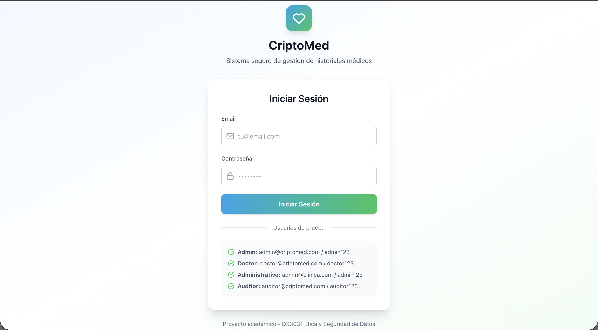
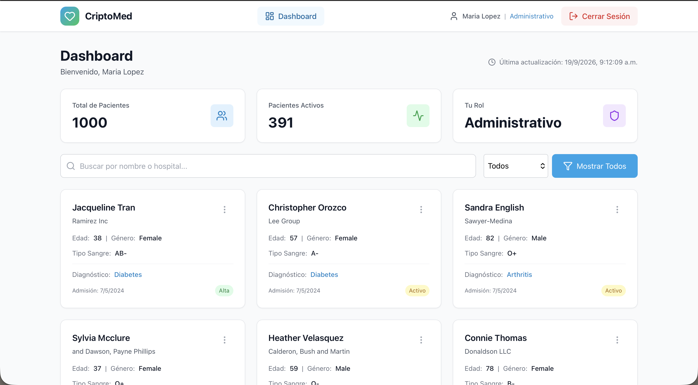
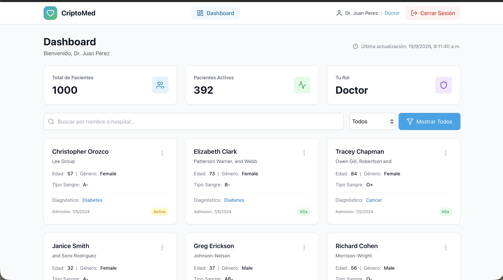
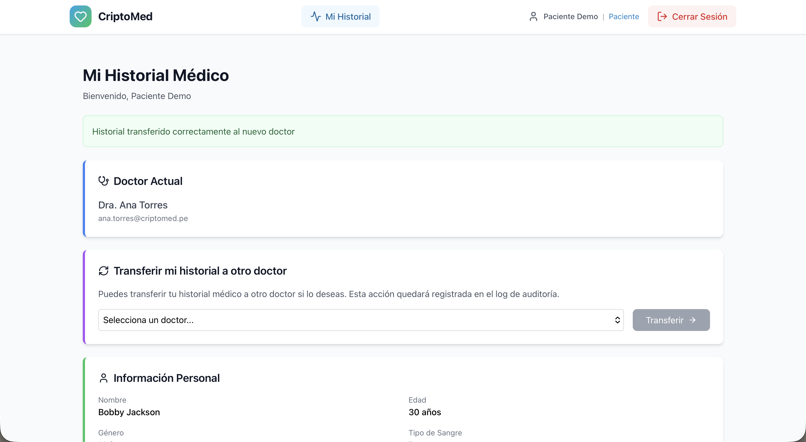
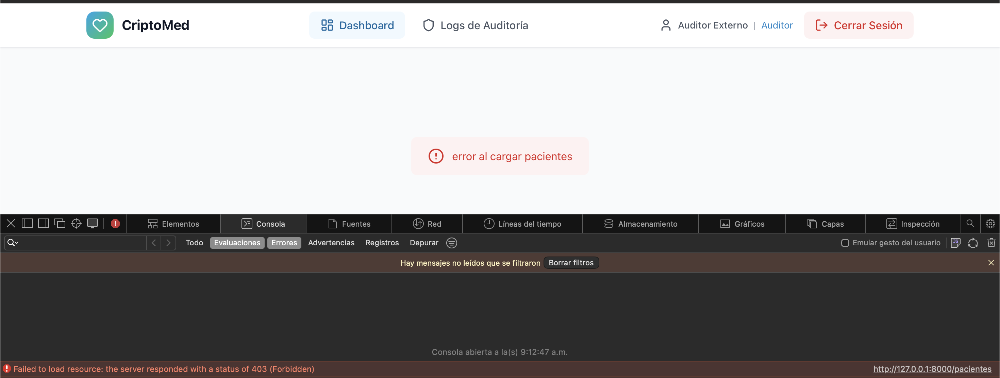
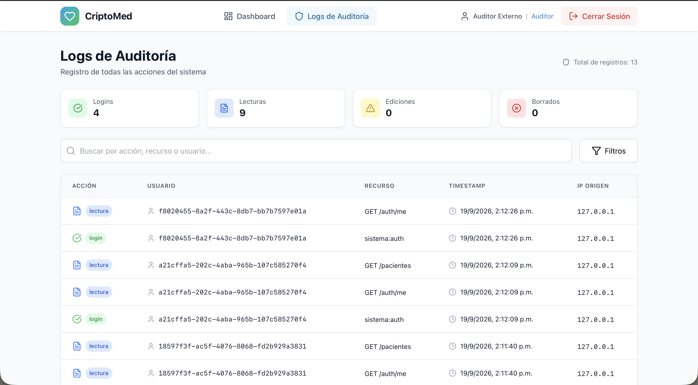
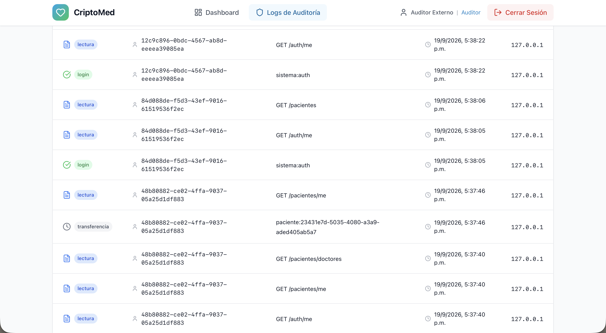

# Presentación - CriptoMed

**Proyecto:** CriptoMed – Plataforma de Gestión de Historiales Médicos  
**Curso:** DS3031 - Ética y Seguridad de Datos  
**Estudiante:** María Lazon  
**Fecha:** Noviembre 2026  
**Diapositivas:** 12

---

## Diapositiva 1: Portada y problema en una frase

**Título:** CriptoMed: Gestión Segura de Historiales Médicos para Clínicas Pequeñas en Perú

**Viñetas:**
- **Problema:** Clínicas pequeñas manejan historiales en papel o spreadsheets sin protección
- Exposición de datos sensibles, acceso no controlado, incumplimiento de Ley N° 29733
- **Solución:** Plataforma web con AES-256-GCM, RBAC, logs inmutables SHA-256 y TLS 1.3
- **Resultado clave:** 100% campos sensibles cifrados · 61.18% reducción en hallazgos de seguridad

**Notas del orador:**
> "Buenas tardes. Mi proyecto es CriptoMed: un sistema para que clínicas pequeñas en Perú gestionen historiales médicos de forma segura y legal. El problema es que hoy usan papel o Excel sin protección, lo que expone datos de salud sensibles. Diseñé CriptoMed con cifrado AES-256-GCM, control de acceso por roles y logs de auditoría inmutables. Los resultados: 100% de campos sensibles cifrados y una reducción del 61% en hallazgos de seguridad tras aplicar herramientas."

**Captura:** Pantalla de login en https://localhost:8443

---

## Diapositiva 2: Contexto normativo y usuarios

**Título:** Ley 29733 y los 5 roles del sistema

**Viñetas:**
- **Ley N° 29733** (Perú): datos de salud = sensibles; medidas técnicas obligatorias; derechos ARCO
- **Reglamento D.S. 016-2024-JUS** (30 nov. 2024): obligaciones de responsables y encargados; notificación a ANPD en 48 h
- **5 roles:** admin · doctor · administrativo · auditor · paciente
- Mínimo privilegio: administrativo **no ve** diagnóstico, medicación ni resultado de pruebas
- Caso de uso: clínica pequeña con ~500 pacientes sintéticos + catálogo CIE-10 (14,409 códigos)

**Notas del orador:**
> "La Ley 29733 peruana exige proteger datos de salud con medidas técnicas. El Reglamento del 2024 detalla las obligaciones: notificar a la ANPD en 48 horas ante una brecha. Diseñé 5 roles distintos con principio de mínimo privilegio. El caso más claro: el administrativo puede ver facturación pero nunca el diagnóstico del paciente, y ese filtro ocurre en el servidor, no en el frontend."

**Capturas:** Dashboards por rol

---

## Diapositiva 3: Resumen de la Entrega 1

**Título:** Entrega 1: Base del sistema

**Viñetas:**
- Dataset: Healthcare Dataset (501 pacientes sintéticos) + CIE-10 (14,409 códigos)
- Caso de negocio: acceso a historial de ~10 min → **<30 seg**
- KPIs: campos sensibles cifrados, 100% accesos registrados, cumplimiento Ley 29733
- Arquitectura: FastAPI + React + PostgreSQL, desplegado en Render + GitHub Pages
- Cifrado: **Fernet (AES-128-CBC + HMAC)** — limitación observada por el profesor

**Notas del orador:**
> "En E1 construí la base: FastAPI, React, PostgreSQL. Usé datos sintéticos de Kaggle con historial realista. El sistema ya funcionaba con roles y logs, pero el profesor observó que Fernet usa AES-128 y no es un estándar NIST. También notó que la rotación de llaves no estaba implementada. Esas dos observaciones guiaron toda la Entrega 2."

---

## Diapositiva 4: Arquitectura Docker Compose

**Título:** Migración a despliegue local con Docker

**Viñetas:**
- Migración desde Render/GitHub Pages → Docker Compose local (control total de red y llaves)
- **5 servicios:** edge Nginx (TLS 1.3) · backend FastAPI · PostgreSQL 16 · init · backup
- **Solo el edge publica un puerto:** 8443 al host
- `db_net` es red interna: PostgreSQL nunca expuesto al exterior
- Contenedores sin root · cap_drop ALL · read-only filesystem · no-new-privileges

**Notas del orador:**
> "Para E2 migré a Docker Compose local para tener control de aislamiento de red y gestión de llaves. Solo el edge publica el puerto 8443. La base de datos está en una red interna imposible de alcanzar desde fuera. Los contenedores corren sin root y con capacidades mínimas, siguiendo CIS Docker Benchmark y OWASP Docker Security."

**Diagrama:** Mermaid de servicios y redes del README

---

## Diapositiva 5: Cifrado en reposo y rotación de llaves

**Título:** De Fernet a AES-256-GCM

**Viñetas:**
- **Decisión:** AES-256-GCM (FIPS 197 · NIST SP 800-38D) · integridad integrada (tag de autenticación)
- **vs. Fernet descartado:** AES-128-CBC, no estándar NIST, 128 bits de clave de cifrado
- **AAD** = `pacientes.nombre.{id}` → impide copiar un cifrado entre registros
- **Llaves versionadas:** `v1:…, v2:…` · rotación en 3 pasos sin interrumpir servicio
- **Evidencia:** `SELECT` muestra `v2:…` · `scripts/verificar_cifrado.py` · demo rotación en vivo

**Notas del orador:**
> "Migré de Fernet a AES-256-GCM. La diferencia clave: GCM tiene autenticación integrada, 256 bits y está definido en un estándar NIST. El AAD vincula cada valor cifrado al ID del paciente, impidiendo que un atacante copie un valor cifrado a otro registro. Las llaves están versionadas, lo que permite rotar sin borrar datos: muestro eso en vivo."

---

## Diapositiva 6: Identidad, acceso y control del paciente

**Título:** Autenticación RBAC + autonomía del titular

**Viñetas:**
- **Contraseñas:** bcrypt factor 12 · política NIST SP 800-63B (mín. 12 chars · sin rotación forzada · zxcvbn)
- **JWT:** HS256 · exp 30 min · verificación `activo` en cada request → revocación inmediata
- **Bloqueo:** 5 intentos → 15 min · rate limiting 10 req/min (slowapi)
- **Paciente (self-service):** ve historial · ve quién accedió · descarga sus datos · transfiere doctor con confirmación explícita
- **Break-glass:** doctor no asignado accede 30 min con justificación ≥20 chars → registrado y auditable

**Notas del orador:**
> "El paciente tiene control real: puede ver quién consultó su historial, exportar sus datos en JSON y transferir a otro doctor con un diálogo de confirmación. Todo queda registrado. Implementé también break-glass: si llega una emergencia, un doctor no asignado puede acceder 30 minutos con justificación médica, pero queda registrado como alerta para el auditor. Es la tensión ética clásica entre seguridad y atención oportuna."

**Capturas:**

---

## Diapositiva 7: Trazabilidad — logs inmutables SHA-256

**Título:** Logs con cadena de hashes verificable

**Viñetas:**
- **9 acciones registradas:** login · login_fallido · bloqueo · lectura · edición · borrado · transferencia · exportación · acceso_emergencia
- **Cadena SHA-256:** `hash_actual = SHA-256(hash_prev | usuario | acción | recurso | timestamp | IP | detalle)`
- `pg_advisory_xact_lock` → serializa escrituras, evita condición de carrera
- **Triggers** anti-UPDATE/DELETE · rol `app_user` con solo INSERT/SELECT
- **Demo:** verificar → OK · alterar fila → verificar → **FALLA** señalando la fila exacta

**Notas del orador:**
> "En E1 dije que los logs eran inmutables, pero no lo eran. Ahora sí: cada registro incluye el hash del anterior formando una cadena. Si alguien con acceso de superusuario modifica una fila manualmente, el script de verificación detecta exactamente dónde se rompió la cadena. Lo demuestro en vivo alterando un log y mostrando la falla."

**Capturas:**

---

## Diapositiva 8: Análisis con herramientas de seguridad

**Título:** Antes y después: −61.18% en hallazgos

**Viñetas:**
- **8 herramientas:** Bandit · pip-audit · npm audit · Gitleaks · Hadolint · Trivy · testssl.sh · OWASP ZAP
- **Antes:** 3,596 hallazgos · **Después:** 1,396 hallazgos → **reducción 61.18%**
- Correcciones principales:
  - Inyección SQL en `verificar_restauracion.py` (Bandit)
  - `python-multipart` y `python-dotenv` actualizados (pip-audit CVEs)
  - Cabecera `Cross-Origin-Resource-Policy` agregada (ZAP)
- Hallazgos no corregidos: documentados con justificación en `docs/hallazgos.md`

**Notas del orador:**
> "Apliqué 8 herramientas antes y después de las correcciones. La reducción fue del 61%. Corregí inyecciones SQL, actualicé dependencias con CVEs y agregué cabeceras de seguridad faltantes. Los hallazgos que no corregí están documentados con justificación: falsos positivos o riesgos aceptados con controles compensatorios."

---

## Diapositiva 9: DPIA — riesgos para los titulares

**Título:** Evaluación de Impacto en la Protección de Datos

**Viñetas:**
- DPIA conforme a GDPR Art. 35 e ISO/IEC 29134 · 12 riesgos identificados
- **Top 3 riesgos para pacientes:**

| Riesgo | R. inherente | Mitigación | R. residual |
|--------|-------------|------------|-------------|
| Fuga masiva de BD | 5×5 = 25 | AES-256-GCM + TLS 1.3 | 2 |
| Acceso indebido interno | 3×5 = 15 | RBAC + logs inmutables | 2 |
| Indisponibilidad en emergencia | 3×4 = 12 | Break-glass 30 min | 2 |

- Tensión ética: cancelación del titular **vs.** conservación legal 20 años (norma MINSA R.M. 214-2018)
- Datos sintéticos en pruebas; IA generativa revisada con pruebas + escaneos

**Notas del orador:**
> "La DPIA evalúa riesgos para los pacientes, no para la clínica. El riesgo más alto antes de controles es fuga masiva: 25 de 25. Tras AES-256-GCM y TLS 1.3 baja a 2. La tensión ética más interesante es que el paciente tiene derecho a cancelar sus datos, pero la norma MINSA exige conservar la historia clínica 20 años. Documenté esa tensión honestamente en la DPIA."

---

## Diapositiva 10: Objetivos vs. resultados

**Título:** 28/28 requisitos implementados

**Viñetas:**
- **28 requisitos verificados:** 28 implementados · 0 parciales · 0 no implementados
- KPIs alcanzados:

| KPI | Resultado |
|-----|-----------|
| Campos sensibles cifrados | 100% (AES-256-GCM) |
| Accesos registrados | 100% (9 tipos de acción) |
| Tiempo de acceso a historial | <30 seg (vs. ~10 min en papel) |
| Reducción hallazgos seguridad | 61.18% (3,596 → 1,396) |
| RPO / RTO | 24 h / <30 min (medido) |

- Herramienta de análisis: aplicada con evidencia antes/después
- DPIA: completa con 12 riesgos · ciclo de vida · plan de revisión anual

**Notas del orador:**
> "Cumplí los 28 requisitos. Los KPIs son medibles y verificables en el repositorio: scripts de verificación, reportes de escaneo, métricas reales en el Dashboard Oficial. El RTO de menos de 30 minutos fue medido en una prueba real de restauración de backup, no estimado."

---

## Diapositiva 11: Limitaciones y trabajo futuro

**Título:** Honestidad sobre lo que queda pendiente

**Viñetas:**
- **Limitaciones declaradas** (riesgo aceptado, no ignorado):
  - Token en `localStorage` (XSS) → mitigado con CSP estricta + sin `dangerouslySetInnerHTML`
  - Llaves en variables de entorno → en producción: KMS/HSM con cifrado de sobre
  - Certificado autofirmado → en producción: Let's Encrypt / CA reconocida
  - Retención: política formal pendiente (20 años según norma MINSA)
- **Trabajo futuro prioritario:**
  - MFA para todos los roles
  - Argon2id en lugar de bcrypt
  - Cookies HttpOnly + Secure + SameSite (elimina riesgo XSS del token)
  - Anclaje externo del hash de logs (mitiga al atacante con control del servidor)

**Notas del orador:**
> "Ser honesto sobre las limitaciones puntúa más que fingir que todo está resuelto. El token en localStorage es un riesgo aceptado documentado en docs/RIESGOS_ACEPTADOS.md con cinco controles compensatorios. Las llaves en variables de entorno es la limitación más importante para producción real: en un entorno real irían en un HSM. El trabajo futuro está priorizado y justificado."

---

## Diapositiva 12: Lecciones aprendidas → demo en vivo

**Título:** Lecciones aprendidas

**Viñetas:**
- **Empezar:** verificar la especificación antes de afirmar (Fernet vs. AES-256 lo enseñó)
- **Empezar:** DPIA y modelo de amenazas antes de programar, no al final
- **Parar:** asumir que "cifrar con una librería" justifica el algoritmo
- **Parar:** el código generado con IA no se acepta sin revisión humana + pruebas
- **Continuar:** una fase = un commit = una evidencia verificable
- **Reflexión:** la transferencia de doctor surgió de validar con el profesor a tiempo → es la feature más vistosa

**Notas del orador:**
> "La lección más importante: cifrar no es lo mismo que poder justificar el algoritmo. Fernet funciona bien técnicamente, pero no puedo defenderlo ante un estándar NIST. También aprendí que hacer la DPIA al final es tarde: haberla hecho antes habría cambiado decisiones de diseño. Ahora paso a la demo en vivo de 10 minutos donde muestro cada medida de seguridad funcionando."

---

## Notas de producción para PowerPoint/Google Slides

**Diseño recomendado:**
- Fondo blanco o gris muy claro, tipografía sans-serif (Inter, Roboto)
- Máximo 5 viñetas por diapositiva — si hay tabla, quitar viñetas adicionales
- Capturas: al menos 1 por diapositiva donde existe imagen real

**Capturas disponibles en docs/images/:**
- `login.png` → D1
- `admin_sistema_dashboard.png`, `admin_clinica_dashboard.png`, `doctor_dashboard.png` → D2
- `bobby_tranfiere_ana.png`, `auditor_dashboard_denegado.png` → D6
- `auditor_logs.png`, `logs_transferencia.png`, `JWT_logs.png` → D7
- `ana_no_bobby.png`, `luis_si_bobby.png`, `ana_ahora_si_bobby.png`, `luis_ya_no_bobby.png` → D6 (secuencia de transferencia)

**Preguntas probables del profesor y respuesta corta:**

| Pregunta | Respuesta |
|----------|-----------|
| ¿Por qué GCM y no Fernet? | GCM es estándar NIST (SP 800-38D), 256 bits de clave, integridad integrada. Fernet usa 128 bits y no tiene definición NIST. |
| ¿Dónde guardas la llave? | Variables de entorno en `.env`. En producción: KMS/HSM con cifrado de sobre. |
| ¿Qué pasa si se pierde la llave? | Los datos cifrados son irrecuperables. Por eso las llaves se respaldan separadas de los dumps. |
| ¿Qué pasa si un doctor se va? | El admin revoca `activo=False`. El JWT falla en la siguiente request. El nuevo doctor se asigna vía transferencia. |
| ¿Por qué certificado autofirmado? | Para demo local. En producción: Let's Encrypt o CA corporativa. TLS 1.3 es el mismo independientemente de quién firma. |
| ¿Quién puede alterar los logs? | Solo un superusuario de PostgreSQL puede desactivar los triggers. `app_user` solo tiene INSERT/SELECT. Si alguien altera una fila, `verificar_cadena_logs.py` lo detecta. |
| ¿Qué es el break-glass? | Acceso de emergencia para doctores no asignados: 30 min, requiere justificación ≥20 chars, aparece como alerta ALTA para el auditor. Responde a la tensión ética seguridad vs. atención oportuna. |
